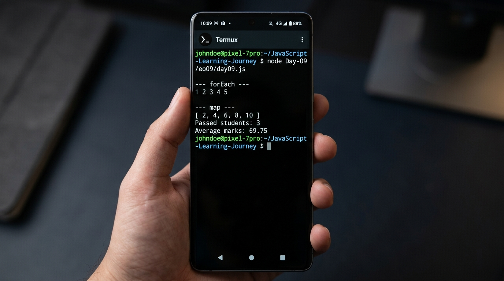
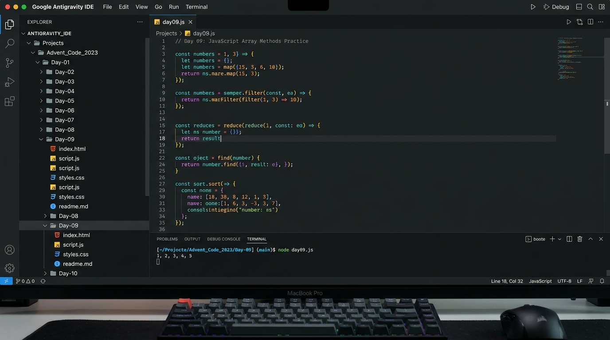
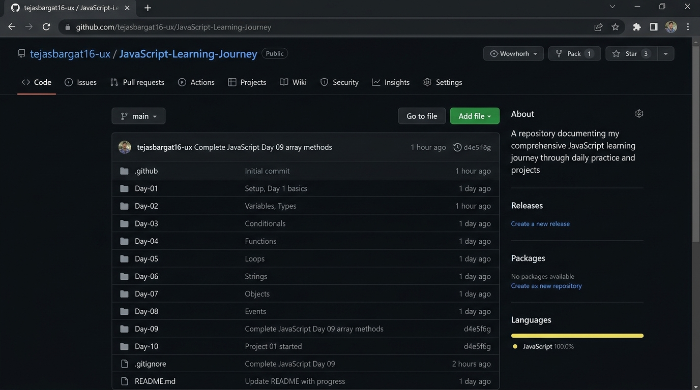
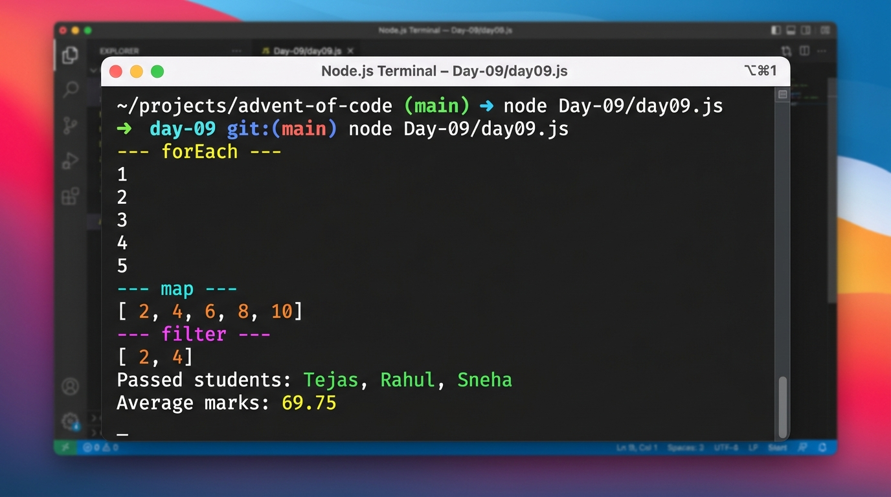
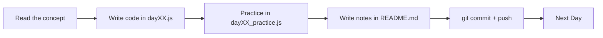
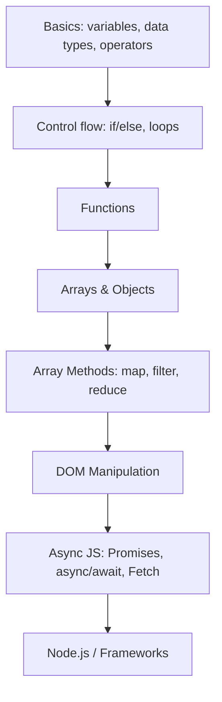

# 🚀 JavaScript Learning Journey


My journey of learning JavaScript through daily practice. Every day has its own folder containing code, practice problems, and notes.

## 📅 Progress

<!-- PROGRESS:START -->

| Day | Topic | Status | Folder |
|:---|:---|:---:|:---|
| Day 01 | JavaScript Basics | ✅ | [Day-01](./Day-01) |
| Day 02 | Operators, Input & Type Conversion | ✅ | [Day-02](./Day-02) |
| Day 03 | Conditional Statements | ✅ | [Day-03](./Day-03) |
| Day 04 | | Problem| Concept | ✅ | [Day-04](./Day-04) |
| Day 05 | | Problem| Concepts | ✅ | [Day-05](./Day-05) |
| Day 06 | Arrays | ✅ | [Day-06](./Day-06) |
| Day 07 | Objects | ✅ | [Day-07](./Day-07) |
| Day 08 | Strings & String Methods | ✅ | [Day-08](./Day-08) |
| Day 09 | Array Methods | ✅ | [Day-09](./Day-09) |
| Day 10 | Destructuring & Spread | ⏳ | [Day-10](./Day-10) |

<!-- PROGRESS:END -->

## 📸 Screenshots

| Running code in Termux | Antigravity IDE |
|---|---|
|  |  |

| GitHub Repo | Day 09 Output |
|---|---|
|  |  |

## 🏗️ Architecture

### Repo Layout (Detailed)

```text
JavaScript-Learning-Journey/
│
├── Day-01/
│   ├── day01.js              # Concept code + comments
│   ├── day01_practice.js     # Practice problems
│   └── README.md             # Notes, syntax, common mistakes
│
├── Day-02/
│   ├── day02.js
│   ├── day02_practice.js
│   └── README.md
│
├── Day-03/
│   ├── day03.js
│   ├── day03_practice.js
│   └── README.md
│
├── Day-04/
│   ├── day04.js
│   ├── day04_practice.js
│   └── README.md
│
├── Day-05/
│   ├── day05.js
│   ├── day05_practice.js
│   └── README.md
│
├── Day-06/
│   ├── day06.js
│   ├── day06_practice.js
│   └── README.md
│
├── Day-07/
│   ├── day07.js
│   ├── day07_practice.js
│   └── README.md
│
├── Day-08/
│   ├── day08.js
│   ├── day08_practice.js
│   └── README.md
│
├── Day-09/                   # Array methods
│   ├── day09.js              # forEach, map, filter, find, some, every, reduce
│   ├── day09_practice.js     # Practice on array methods
│   └── README.md             # Notes on array methods
│
├── Day-10/                   # Destructuring & Spread
│   ├── day10.js
│   ├── day10_practice.js
│   └── README.md
│
├── assets/                   # Images used in this README
│   ├── banner.png
│   ├── termux-output.png
│   ├── antigravity.png
│   ├── github-repo.png
│   └── day09-output.png
│
├── .github/
│   └── workflows/
│       └── update-readme.yml   # Auto-updates README on push
│
├── scripts/
│   └── update-readme.js        # Builds the Progress table
│
├── .gitignore                # node_modules/, .env, *.log
└── README.md                 # Main overview (this file)
```

### Top-level Files & Folders

| Path | Type | Purpose |
|------|------|---------|
| `Day-XX/` | Folder | All learning material for a single day |
| `assets/` | Folder | Photos and screenshots used in this README |
| `.github/workflows/` | Folder | GitHub Actions automation |
| `scripts/` | Folder | Helper scripts used by the workflow |
| `.gitignore` | File | Keeps unwanted files out of Git |
| `README.md` | File | Repo overview, progress, and architecture |

### Day-wise Folder Index

| Folder | Topic | Files |
|--------|-------|-------|
| `Day-01` | Basics, Variables & Data Types | `day01.js`, `day01_practice.js`, `README.md` |
| `Day-02` | Operators, Input & Type Conversion | `day02.js`, `day02_practice.js`, `README.md` |
| `Day-03` | Conditional Statements | `day03.js`, `day03_practice.js`, `README.md` |
| `Day-04` | Loops | `day04.js`, `day04_practice.js`, `README.md` |
| `Day-05` | Functions | `day05.js`, `day05_practice.js`, `README.md` |
| `Day-06` | Arrays | `day06.js`, `day06_practice.js`, `README.md` |
| `Day-07` | Objects | `day07.js`, `day07_practice.js`, `README.md` |
| `Day-08` | Strings & String Methods | `day08.js`, `day08_practice.js`, `README.md` |
| `Day-09` | Array Methods | `day09.js`, `day09_practice.js`, `README.md` |
| `Day-10` | Destructuring & Spread | `day10.js`, `day10_practice.js`, `README.md` |

### Day README Template

Every `Day-XX/README.md` follows this structure:

```markdown
# Day XX: <Topic>

## 📌 Concept
A short explanation in my own words.

## 🧪 Syntax
Code snippet.

## 💡 Examples
2-3 small examples with output.

## ⚠️ Common Mistakes
Mistakes I made or could easily make.

## ✅ Practice
What I solved in `dayXX_practice.js`.
```

### Each Day Folder Pattern

| File | Purpose |
|------|---------|
| `dayXX.js` | The day's concept, with commented examples |
| `dayXX_practice.js` | Practice problems I wrote myself |
| `README.md` | Concept summary, syntax, and common mistakes |

### Learning Flow



### Learning Roadmap



### Naming Conventions

- Folders: `Day-XX` (zero-padded, e.g. `Day-09`)
- Files: `dayXX.js`, `dayXX_practice.js`
- Commits: `Day 09: array methods` or `docs: update README`

### Workflow (Termux)

```bash
cd JavaScript-Learning-Journey
mkdir Day-10 && cd Day-10
touch day10.js day10_practice.js README.md
node day10.js                      # run & test
cd ..
git add .
git commit -m "Day 10: <topic>"
git push
```

## 🤖 Automation

Every time I push a `Day-XX` folder, a GitHub Action runs `scripts/update-readme.js` and refreshes the Progress table above.

- **Topic** is read from the heading of `Day-XX/README.md` or `dayXX.js`
- **Status** is ✅ when `dayXX.js` has code, ⏳ when it is empty
- The bot commits the change with `[skip ci]`, so it never loops

## ▶️ How to Run

**Termux (Android):**
```bash
pkg install nodejs
git clone https://github.com/tejasbargat16-ux/JavaScript-Learning-Journey.git
cd JavaScript-Learning-Journey/Day-09
node day09.js
```

**Laptop / PC:**
```bash
node Day-09/day09.js
```

## 🎯 Goal

Build a strong JavaScript foundation, then move on to Node.js and frontend frameworks, and build real projects.

## 🛠️ Tools

- JavaScript (ES6+)
- Node.js
- Git & GitHub
- Termux (Android)
- Google Antigravity (AI-powered IDE)

## 👤 Author

**Tejas** · [@tejasbargat16-ux](https://github.com/tejasbargat16-ux)

⭐ If you find this helpful, give it a star!
